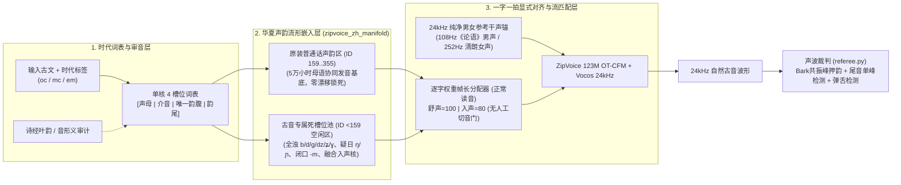
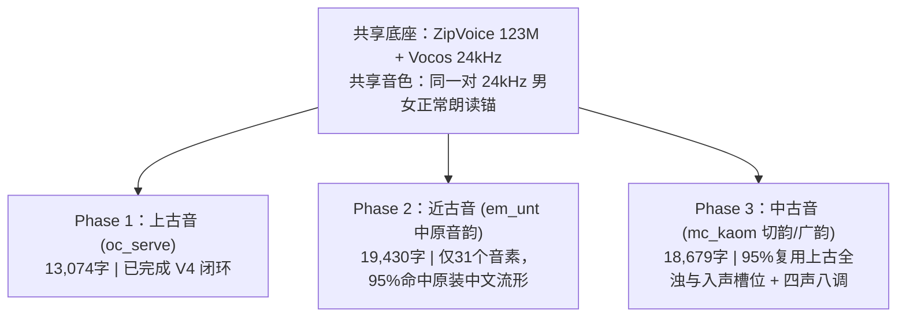

# 汉火古音 TTS（上古 → 近古 → 中古）总体架构与工程实施方案

> **版本**：v2.1（2026-11-17 更新：打通 V5 上古/中古/近古三代联合词表 + W8A8 INT8 量化感知训练 QAT）  
> **已锁定核心底座**：**`ZipVoice` (123M, Apache-2.0) 中文声韵流形嵌入手术 + 一字一拍显式帧对齐 + W8A8 INT8 QAT (`128MB`) + `Vocos` 24kHz 全频段神经声码器**  
> **发音与审美基调**：**正常读音（不搞夸张吟诵拖腔、不套现代普通话上挑腔）** · **严格一字一音** · **弹舌克制** · **读诗押韵** · **1 男 1 女双真人音色贯通三代**

---

## 一、设计总纲与四条铁律

1. **一字一音（绝对红线）**：每个汉字严格对应唯一音节核，既禁止多合元音拆拍（如 `keau` 拆三拍），也禁止入声塞尾除阻爆破出第二音节（如 `侧` 读成两拍“咋可”），同时不许用生硬静音门一刀切掉人体声道自然余振。
2. **正常读音、华夏咬字**：摒弃“外国人逐字母拼读 IPA 音标”的生硬感，也无需刻意做作的吟诵拖腔；基于中文母语协同发音流形，呈现自然沉稳的古汉语正常朗读节奏。
3. **读诗必押韵 + 音形义审音**：以符号韵基距离与声波共振峰 $(F_1, F_2, F_3)$ Bark 尺度距离双重校验《诗经》/《广韵》押韵；在词表审音层结合字形谐声链与本义开闭口/舒促象似性（寒冷幽闭用低 $F_1$ 敛口音，光明旷远用高 $F_1$ 洪音 `a`，急迫郁结用唯闭促声 `-p/-t/-k`）。
4. **弹舌克制、双音色统一**：严控 20–32Hz 俄式大舌颤音；固定 **1 男（108Hz 沉稳学者男声）+ 1 女（252Hz 清朗女声）** 纯净 24kHz 参考锚（正式商用前可零训练无缝替换为自有版权干声），让同一对男女声跨越先秦、隋唐、元明三代。

---

## 二、底座选型复盘：为什么最终锁定 `ZipVoice` 中文流形方案？

经过五种技术路线的实测对比，各方案优劣与去留结论如下：

| 候选底座 | 实测现象与淘汰/保留原因 | 结论 |
| :--- | :--- | :---: |
| **`SPARC` (14维口腔轨迹)** | 依赖 16kHz 电磁发音轨迹逆合成，机器电子合成音质感重，缺乏真人声带泛音细节。 | ❌ 淘汰 |
| **`OmniVoice` (社区 IPA 版)** | ① 原版缺 29 个 IPA 符号；② 社区版由 28 种外语贪婪微调，单字 `kʰet` 实测裂成 3 峰、四字裂成 6 峰；③ 仅 INT4 ONNX 无法微调；④ `CC-BY-NC` 协议禁止商用；⑤ CPU 单字需 20~30s。 | ❌ 淘汰 |
| **`VoxCPM2` (2B LM + DiT)** | 原生 `<\|ipa\|>` 丢时长先验全乱；借道美式英语 39 个 `{CMU}` 音标有损丢音位；自回归时长不稳，需每句重抽 6 次筛坏例且仍有顽固双拍；2B 体量比 `ZipVoice` 重 16 倍。 | ❌ 淘汰 |
| **`DiaMoE-TTS` (11方言 MoE)** | 虽含吴语浊音与粤语入声词表，但其门控为**整句单专家 (`topK=1`)**：当一句古文混有跨方言声韵组合时，实测会出现吞声母与入声弹尾伪影。 | ❌ 淘汰直出 |
| **`ZipVoice` + 中文声韵流形 (V4)** | ① **123M 轻量 Apache-2.0**（2080 Ti 整首诗 ~1.5s）；② **5 万小时中文声母+韵母子空间**天然消除外语读音标感；③ **逐字帧长硬索引 (`get_tokens_index`)** 1 次生成即 100% 锁死一字一拍；④ **原生 24kHz Vocos** 男女零样本克隆通透自然。 | **✅ 正式锁定** |

> **关键踩坑警示（勿重蹈 V1/V2 覆辙）**：
> - 严禁删掉 `ZipVoice` 预训练 `embed.weight` 从头训未对齐长句（必致 V1 糊音）或喂 16kHz 窄带音频微调声码层（必抹平 >8kHz 泛音产生金属电音）；
> - 严禁直接喂 `ZipVoice` 前半段 `ID 14..158` 英文 IPA 区（其中 `q, ɢ, ɯ, ʰ, ˤ, g, ʦ, ̊` 等 139 个符号实测 L2 范数仅 `~1.3`，是从未训练过的随机死向量！）。

---

## 三、现行核心架构详解（V4 已落地验证）

### 3.1 四大核心机制
1. **单核 4 槽位归一化 (`hanfire_core/phonology.py`)**：将任意复元音拟音（如 `keau`, `ʔiei`）按响度阶归并为 `[Onset | Medial | Nucleus | Coda]`，从源头消灭多核拆拍。
2. **中文流形内向量合成与球面精调 (`hanfire_core/zipvoice_zh_manifold.py`)**：
   - 仅占用 `ID < 159` 及 `356..359` 的 **76 个纯净未训练空闲槽位**（绝不触碰 `159..355` 任何普通话拼音及轻声词元）；
   - 入声 `-p/-t/-k` 采用**单 token 融合入声韵母 (`OC_*_chk`)** 配合 `80` 权重自然短收，既根除普通话声母除阻造成的“咋可”双拍，又保留声道自然闭合余振（无生硬掐断感）；
   - 使用 `assets` 录音室级无伴奏单字/连绵词干声（69 条 `-160dB` 数字静音底噪真人上古干声）在冻结编码器的前提下做**球面范数约束嵌入精调**（`embed` 独立参数组 `weight_decay=0.0`，原装词元漂移严格为 `0.0`）。
3. **正常读音平调策略**：平声统一采用平稳舒展调值（`Tone 1`），上声源（`-ʔ`）微折（`Tone 3`），去声源（`-h`）自然缓降（`Tone 4`），不再给浊平强套现代普通话阳平 35 上挑调，消除现代腔。
4. **后期“个别怪音”三级增量热修机制（免重训全模型）**：
   - **L1 字典级（0 秒）**：单字异读不顺耳 → 直接改词表 JSON/TSV，0 秒生效；
   - **L2 单音素槽位级（30~60 秒）**：某类特定声母/韵母偏怪 → 梯度掩码**仅打开该 1~4 个槽位 ID**，其余 356 个词元与解码器全部焊死，喂 5~10 条示范干声在 2080 Ti 上跑半分钟即可定向修准，其余字波形 100% 零变化；
   - **L3 声学过渡级（3~5 分钟）**：某类发音动作（如全浊塞音预振动）需增强 → 冻结 `Vocos` 与原词表，仅外挂几 MB 的极轻量 `LoRA (rank=4~8)` 插件，可随时插拔回滚。

---

## 四、中古音（隋唐切韵）与近古音（元明中原音韵）实施方案

依托 **「同一套 123M `ZipVoice + Vocos` 底座 + 同一对男女参考锚 + 分时代词表与可插拔嵌入表 (`era = oc | mc | em`)」**，无需另起新架构即可打通三代。建议按**“先近古（最快落地）→ 再中古（复用上古全浊/入声资产）”**顺序推进：

### 4.1 近古音实施方案（元明早期官话 ·《中原音韵》`em_unt`）
1. **既有数据家底**：`pron.duckdb` 与 `em_train.tsv` 已备齐 **19,430 字、2,892 音节**，且自带精确调类列（`陰、陽、上、去、入作陽、入作上、入作去`）；另有 `sent_pairs/{ppx_ming, baozhao_ming, caicha_ming}` 明代官话对齐真人句对。
2. **音系特点与映射（几乎零训练成本）**：
   - 近古音已完成“全浊清化”与“入派三声”，全表仅 **31 个音素原子**，95% 直接命中 `ZipVoice` 原装 5 万小时中文词元！
   - **四大时代特征实现**：
     1. **分尖团、见组细音不颚化**（如 `秋 tsʰiw` vs `丘 kʰiw`、`江 kjaŋ`）：`ZipVoice` 声韵双 token 体制（`c0+iu` vs `k0+iu`、`g0+iang`）**零训练原生支持**！
     2. **闭口韵 `-m`**（侵寻/监咸/廉纤，如 `深 ʂəm`、`心 sim`）：**100% 复用**上古 V4 已建好的 `OC_əm / OC_am / OC_iam + OC_coda_m` 槽位！
     3. **疑母 `ŋ-` 与微母唇齿近音 `ʋ-`**（如 `我 ŋɔ`、`微 ʋi`）：复用 `OC_ŋ`，仅需在空闲池新增 **1 个 `EM_ʋ`**（`w0 + v` 融合槽）！
     4. **声调映射（含入派三声）**：`陰 → 1`、`陽/入作陽 → 2`、`上/入作上 → 3`、`去/入作去 → 4`（元明官话四声格局与现代官话同源，直接映射自然地道）。
3. **押韵裁判切换**：词韵/曲韵按《中原音韵》十九韵部（东钟、江阳、支思、齐微…）自动校验元曲与明代诗词押韵。

### 4.2 中古音实施方案（隋唐《切韵 / 广韵》体系 · `mc_kaom`）
1. **既有数据家底**：`mc_train.tsv` + `mc_kaom_wangli.tsv` 已备齐 **18,679 字、2,506 音节、48 个音素原子**，每字均带明确的 **`平 / 上 / 去 / 入`** 四声标记；另有 `assets/蒹葭…中古音对比_1080P.mp4` 及 `sent_pairs/{chushibiao, wanghai_mc}` 真人中古音朗读素材。
2. **音素槽位复用与扩充（95% 现成）**：
   - **声母（三十六字母全套）**：全浊塞音/塞擦音/擦音（並 `b`、定 `d`、群 `ɡ`、从 `dz`、邪 `z`、澄 `dʒ`、船禅 `dʑ/ʑ`、匣 `ɣ`）及疑母 `ŋ`、日母 `ɲ`、知庄章三组声母，**已全部包含在上古 V4 槽位中，无需重建**！
   - **韵母与入声尾**：三大鼻尾（`-m/-n/-ŋ`）与三大入声塞尾（`-p/-t/-k` 对应缉合、质月、屋德诸韵）完全复用 V4；仅需利用 `DEAD_SLOT_POOL` 剩余的 23 个空位补充 **6~8 个中古特色元音核**（如鱼韵 `ɨə`、虞韵 `ʉo`、哈灰韵 `ɒi`、覃谈一二等区分 `ɒm/am`）。
3. **切韵“四声八调”声调实现**：
   中古音是格律诗（唐诗近体诗）的核心载体，必须体现清晰的**平仄对立与清浊阴阳分化**：
   - **清平（阴平）** → `Tone 1`（高平舒展）
   - **浊平（阳平，全浊/次浊声母）** → `Tone 2`（低起缓升）
   - **清上 / 次浊上** → `Tone 3`（微折上扬）；**全浊上** → 可选保持浊上或按晚唐“全浊上变去”归 `Tone 4`
   - **清去 / 浊去** → `Tone 4`（降调）
   - **清入 / 浊入** → 融合短促入声核 `MC_*_chk`（时长权重 `78`，仄声短收，与平声权重 `105` 形成鲜明唐诗“平长仄短”格律节奏！）。
4. **微调与押韵验收**：
   - 从中古音真人视频/句对中切取无伴奏单字与五七言短句，专门精调中古嵌入表 `embed_mc.pt`（必要时挂一个几 MB 的 `lora_mc.pt` 强化三十六字母清浊松紧对立）；
   - 押韵裁判切换至**《平水韵》106 部 + 近体诗平仄格律检验**，用《春晓》《春望》《琵琶行》《出师表》跑通全自动声学验收。

---

## 五、W8A8 INT8 量化感知训练 (QAT) 与极轻量落盘部署（V5 新增）

为将 123M 参数的 `ZipVoice` 底座从 `491 MB (FP32)` 压缩至 **`128 MB (INT8, 3.83x 压缩比)`** 且不损失 24kHz 高频泛音与入声清浊细节，V5 引入两阶段 **Teacher-Guided W8A8 STE QAT**（[hanfire_core/qat_int8.py](file:///mnt/s790/project/tts/hanfire_tts/hanfire_core/qat_int8.py)）：

1. **全线性层双形态覆盖（`98.77%` 参数量化）**：
   - 同时包装标准 `nn.Linear / ScaledLinear`（262 层）与 Zipformer 自定义融合层 `ActivationDropoutAndLinear`（100 层，占 FFN 38.8% 参数）；
   - **敏感边界小层保护（`<1.23%` 参数保留 FP32）**：保护 `embed`（86 个古音槽位 + 原装普通话流形）、`fm_decoder.in_proj`、`fm_decoder.out_proj`、`time_emb` 与深度可分离 `Conv1d`，防止流匹配首尾动态范围坍塌。
2. **24kHz 全频段教师速度场蒸馏（消除 16kHz 窄带污染）**：
   - Stage 1 使用 `valid_mel_bins` 掩码（上古 24kHz 干声 `100 bins`，中古/近古 16kHz 真人语料仅监督低频 `80 bins`）训出零高频退化的 `best_fp32.pt`；
   - Stage 2 冻结 `best_fp32` 为教师，对 W8A8 学生模型（逐输出通道对称权重 INT8 `[-127, 127]` + 动态逐 token 对称激活 INT8）执行确定性速度场蒸馏 `MSE(v_student_int8, v_teacher_fp32)`，配合余弦退火锁定离散量化格点。
3. **真 `torch.int8` 打包导出与磁盘直载**：
   - `convert_qat_to_int8_inference` 将全部受控层权重真实转为 1-byte `torch.int8` + `float16` 通道缩放因子落盘为 `best_int8.pt`（`128.0 MB`），可通过 `load_int8_checkpoint` 独立无损加载推理。

---

## 六、算力分工与目录规范

- **本地先调通 + Colab GPU (`A100 / L4`) 全量快训**：本地 RTX 2080 Ti 先跑 `--smoke` 10 秒端到端冒烟自检；确认零报错后一键上传 `8.4 MB` V5 三代数据包至 Colab GPU 全量训练；**无需强制 Google Drive 浏览器交互授权**，训练完毕直接将最优 `best_fp32.pt`、`best_int8.pt` 与三代男女双音色音频拉回本地 `v5_outputs/` 并立即 `colab stop` 关机省费。
- **核心代码入口**：
  - 单核音系解析：[hanfire_core/phonology.py](file:///mnt/s790/project/tts/hanfire_tts/hanfire_core/phonology.py)
  - 三代华夏声韵流形与正常读音控制器 (`ThreeEraHanfireCompiler`)：[hanfire_core/zipvoice_zh_manifold.py](file:///mnt/s790/project/tts/hanfire_tts/hanfire_core/zipvoice_zh_manifold.py)
  - W8A8 INT8 量化感知训练与真 INT8 推理层：[hanfire_core/qat_int8.py](file:///mnt/s790/project/tts/hanfire_tts/hanfire_core/qat_int8.py)
  - 四维声波押韵裁判：[hanfire_core/referee.py](file:///mnt/s790/project/tts/hanfire_tts/hanfire_core/referee.py)
  - V5 三代数据包构建脚本（50,915 字零 OOV 核验）：[scripts/prepare_v5_colab_bundle.py](file:///mnt/s790/project/tts/hanfire_tts/scripts/prepare_v5_colab_bundle.py)
  - ★ V5 三代贯通 + INT8 QAT 主训练与评测脚本：[scripts/colab_train_v5_qat.py](file:///mnt/s790/project/tts/hanfire_tts/scripts/colab_train_v5_qat.py)
  - Colab 零 GDrive 阻塞远程控制脚本：[scripts/colab_ctl.sh](file:///mnt/s790/project/tts/hanfire_tts/scripts/colab_ctl.sh)
